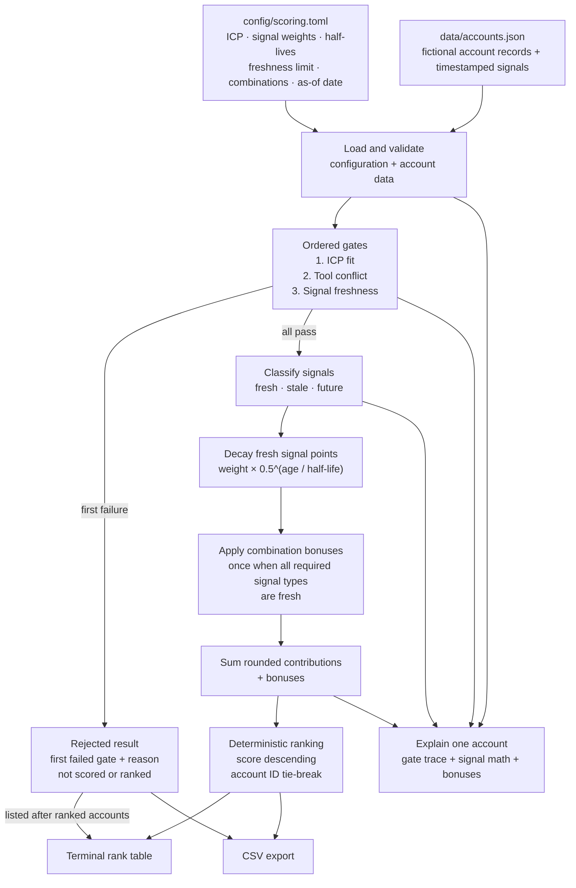

# Architecture: Signal Scoring Engine

This diagram reflects the v1 implementation in this repository. All example accounts and signals are synthetic.

## End-to-end flow

## Module responsibilities

| Module | Responsibility |
|---|---|
| `models.py` | Define the `Account` and `Signal` data structures. |
| `config.py` | Load and validate TOML scoring rules. |
| `data.py` | Load and validate JSON account records. |
| `gates.py` | Classify signal freshness and run short-circuiting rejection gates. |
| `decay.py` | Calculate whole-day age and exponential half-life decay. |
| `scoring.py` | Build signal contributions, apply bonuses, and rank qualified accounts deterministically. |
| `export.py` | Render terminal tables, detailed explanations, and CSV. |
| `cli.py`, `__main__.py` | Expose `rank` and `explain` commands, as `signal-score` or `python -m signal_scoring_engine`. |

## Key contracts

- **Rejection precedes scoring:** only accounts that pass every gate receive a score and rank.
- **One primary rejection reason:** gate evaluation stops at the first failure.
- **Fixed time reference:** freshness and decay use the configured as-of date or an explicit `--as-of` override.
- **Fresh signals only:** stale and future-dated signals do not contribute points; future-dated signals do not count toward freshness or bonuses.
- **Explainable arithmetic:** individual signal contributions are rounded once to two decimal places, then totals are summed from those contributions.
- **Stable output:** qualified accounts sort by score descending and account ID ascending for ties.
- **No external services:** the v1 demo reads local files and has no runtime API, CRM, enrichment, or LLM integration.

## Validation path

GitHub Actions installs the project on Python 3.11, 3.12, and 3.13, runs Ruff lint and formatting checks, executes pytest, and smoke-tests the CLI. The test suite includes gate behaviour, decay, scoring, explain output, CSV export, and deterministic ordering.
